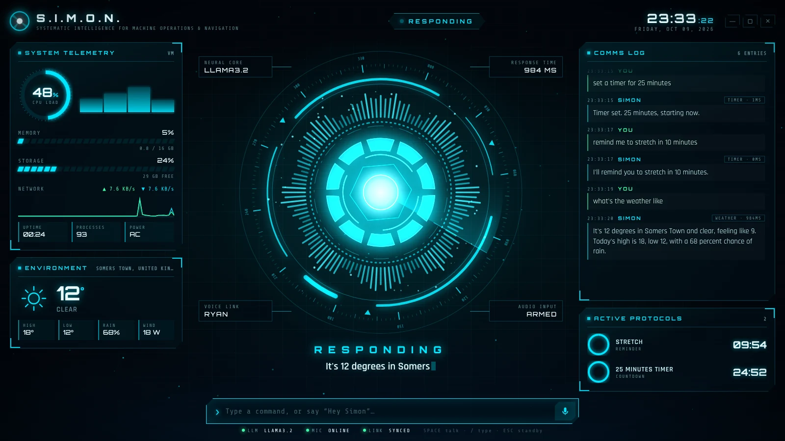
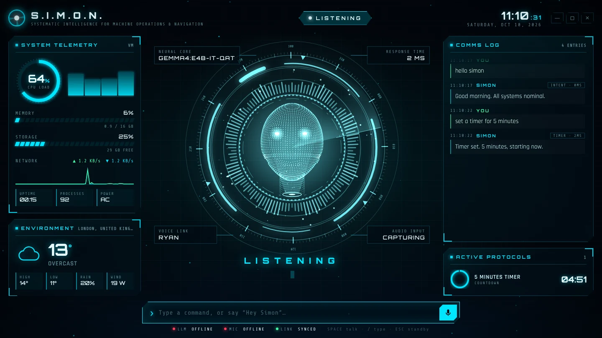
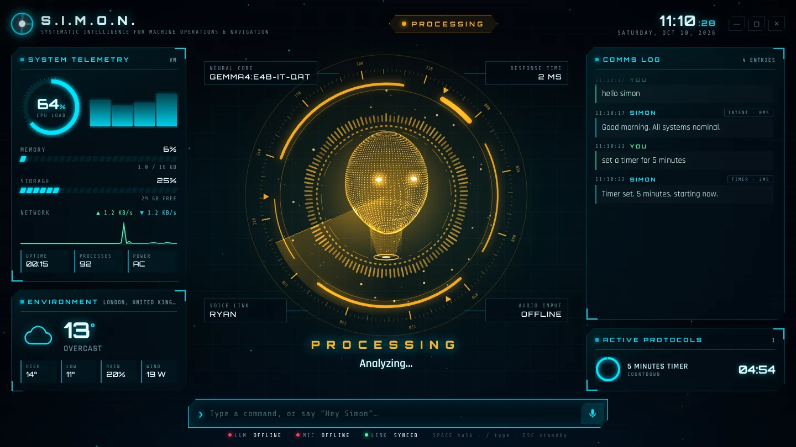
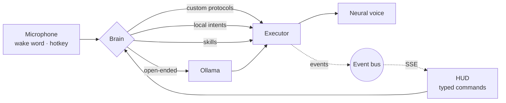

<div align="center">

# S.I.M.O.N.

**Systematic Intelligence for Machine Operations & Navigation**

A cinematic, voice-driven desktop assistant for Windows, powered by a local LLM.




</div>

<br>

## Overview

Say **“Hey Simon”** or press <kbd>Ctrl</kbd> + <kbd>Space</kbd>, and a holographic HUD comes up with Simon's avatar: a floating hologram head, projected above a reactor ring, that speaks with Simon's voice. Simon listens, thinks with a local model through Ollama, replies in a British neural voice, and controls the desktop.

| | |
|---|---|
|  |  |
| **Listening**: the rings ripple with your microphone level | **Processing**: the avatar turns amber while the model thinks |

## Features

- **Holographic avatar**: a scan-line head that materializes on startup, floats, blinks, turns as it thinks and moves its mouth with the voice
- **Cinematic HUD**: boot sequence, audio-reactive rings, system telemetry, weather, comms log, countdown timers, alerts and a shutdown sequence overlay
- **Hands-free**: wake word, push-to-talk hotkey, and follow-up listening without saying the wake word again
- **Fast**: common commands are matched locally and answer instantly; only open-ended requests go to the LLM
- **Degrades gracefully**: if Ollama is down, Simon keeps working on local intents; the voice falls back from Edge to Piper (`voices/jarvis.onnx`) to the system voice
- **Desktop control**: apps (including fuzzy Start Menu search), websites, search, volume, media keys, screenshots, lock, power
- **Skills**: timers and reminders, weather, diagnostics, long-term memory, and desktop file management
- **Safety**: power actions need spoken confirmation, deleted files go to the Recycle Bin, and the HUD API is token-protected and bound to localhost
- **Custom protocols**: chain any actions under a phrase you choose

## Quick start

**Requirements:** Windows 10/11, Python 3.10+, a microphone, and [Ollama](https://ollama.com/download).

```bash
git clone https://github.com/Simonf8/CJ.git
cd CJ
Install.bat
```

Then double-click **`Start Simon.bat`**.

> Speech recognition and the Edge voice need an internet connection. For an offline voice, run `pip install piper-tts`.

<details>
<summary>Manual install</summary>

```bash
python -m venv .venv
.venv\Scripts\activate
pip install -r requirements.txt
ollama pull gemma4:e4b-it-qat
python main.py
```

</details>

## Talking to Simon

| Say | Simon |
|---|---|
| “Hey Simon, open Spotify” | Launches the app |
| “Search YouTube for synthwave” | Opens the results |
| “Set volume to 30” · “Next track” · “Pause” | Controls audio and media |
| “Set a timer for 25 minutes” | Adds a live countdown to the HUD |
| “Remind me to stretch in 10 minutes” | Speaks the reminder and shows an alert when it's due |
| “What's the weather in Tokyo?” | Gives current conditions and today's forecast |
| “Run diagnostics” | Sweeps the HUD and reports CPU, memory, disk and battery |
| “My name is Tony” · “Remember my car is a Tesla” | Saves it to long-term memory |
| “Shut down” → “Confirm” | Starts a 10-second countdown; say “abort” to cancel |
| “House party protocol” | Runs a custom macro |
| “That's all” | Goes to standby |
| Anything else | Answered by the LLM, which can also trigger actions |

### Keyboard

| Key | Action |
|---|---|
| <kbd>Ctrl</kbd> + <kbd>Space</kbd> | Talk (global) |
| <kbd>Space</kbd> | Talk (HUD focused) |
| <kbd>/</kbd> | Type a command |
| <kbd>Esc</kbd> | Standby |
| <kbd>F11</kbd> | Fullscreen |

## Configuration

`config/settings.json` only needs the keys you want to change:

```json
{
  "assistant": { "name": "Simon" },
  "llm":       { "model": "gemma4:e4b-it-qat" },
  "voice":     { "edge_voice": "en-GB-RyanNeural" },
  "listening": { "hotkey": "ctrl+space", "wake_word_enabled": true },
  "hud":       { "fullscreen": false, "avatar": true, "accent": "#00e5ff" },
  "weather":   { "location": "London", "units": "metric" }
}
```

See [`simon/config.py`](simon/config.py) for every option and its default.

### Custom protocols

`config/commands.json` is hot-reloaded, so changes apply without a restart:

```json
{
  "house party protocol": {
    "response": "House party protocol, sir. Turning it up.",
    "actions": [
      { "action": "volume_set", "target": "80" },
      { "action": "open_app", "target": "spotify" }
    ]
  }
}
```

### Command line

```text
python main.py [model] [--browser] [--headless] [--no-mic] [--mute] [--fullscreen] [--port N] [-v]
```

`--browser` opens the HUD in a browser window instead of the native one. `--no-mic --mute` lets you try the HUD silently by typing commands.

## How it works



Every component publishes to a single event bus. The HUD is plain HTML, Canvas and CSS, served locally and streamed live over Server-Sent Events into a frameless native window (pywebview). That's why the visuals are free to look like a film set.

```text
simon/
├── app.py          orchestration and state machine
├── brain.py        protocols → intents → skills → LLM
├── intents.py      instant offline command matching
├── executor.py     desktop actions
├── server.py       HUD server (static files, SSE, API)
├── speech/         microphone, wake word, neural TTS
├── skills/         timer · weather · knowledge · system · files
└── ui/             native window and tray icon
hud/                the interface: reactor, panels, sound effects
```

## Development

```bash
pip install -r requirements-dev.txt
pytest
```

## License

[MIT](LICENSE) · Fonts: Orbitron, Rajdhani and Share Tech Mono (SIL OFL)

<div align="center"><sub>Built by <a href="https://github.com/Simonf8">@Simonf8</a></sub></div>
